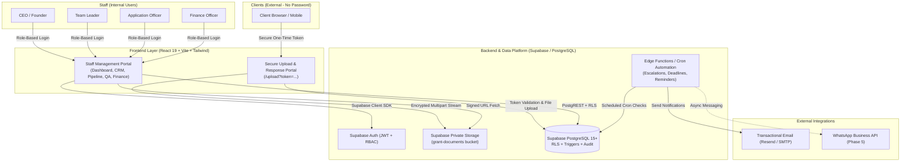

# KIA Grant Management System 2.0 — Target Architecture

**System:** KIA Grant Management System 2.0  
**Organization:** KIA-START UP CONSULT (Accra, Ghana)  
**Author:** Principal Software Architect  
**Version:** 2.0.0-draft  
**Date:** November 12, 2026

---

## 1. Architectural Objectives

1. **Operational Accountability:** Eliminate untracked work by enforcing strict case ownership, task deadlines, automated escalations, and audit logging.
2. **Evidence-Based Records:** Transition from arbitrary checkboxes to verifiable evidence (receipts, stamped forms, review signatures, submission references).
3. **Simplicity for Users:** Streamlined UI tailored for non-technical staff and frictionless, password-less upload links for clients.
4. **Data Isolation & Security:** Enterprise-grade PostgreSQL Row Level Security (RLS), cryptographic upload tokens, private object storage, and Ghana Data Protection Act compliance.
5. **Architectural Continuity:** Retain the fast, responsive React 19 + Vite + Tailwind CSS foundation without unnecessary framework churn.

---

## 2. High-Level System Architecture

---

## 3. Technology Stack Specification

| Tier | Technology | Version | Purpose & Rationale |
|---|---|---|---|
| **Frontend Framework** | React | `^19.3.1` | Existing modern UI runtime; reactive, high performance. |
| **Build & Bundler** | Vite | `^8.3.6` | Sub-second HMR, optimized production tree-shaking. |
| **Styling & Design** | Tailwind CSS | `^4.3.5` | Utility-first, responsive, zero-runtime CSS. |
| **Icons** | Lucide React | `^1.71.0` | Comprehensive enterprise iconography. |
| **Database** | PostgreSQL | `15+` (Supabase) | ACID compliance, JSONB capabilities, RLS, transactional safety. |
| **Object Storage** | Supabase Storage | S3-compatible | Encrypted private file storage with time-limited signed URLs. |
| **Authentication** | Supabase Auth | Native | Email/Password, JWT claims, session refresh, MFA readiness. |
| **State & API Client** | `@supabase/supabase-js` | `^2.49+` | Direct typed data access, real-time table subscriptions. |
| **Client Upload** | Cryptographic Tokens | Node `crypto` / Web Crypto | SHA-256 hashed single-use tokens; zero password fatigue for clients. |
| **Email Service** | Resend / Supabase Auth | API | Transactional notifications, upload links, escalation notices. |

---

## 4. Architectural Subsystems

### 4.1 Hybrid Operating Model: Limited Client Access & Staff Management
Clients will **not** manage full user accounts or navigate complex portals. 
Instead:
- Staff issue an **Upload Request** via the case management dashboard.
- The system generates an unguessable 256-bit cryptographic token, hashes it in the database with an expiration date (default: 72 hours), and generates a magic link:  
  `https://kia-grants.app/upload?token=tok_live_...`
- The client opens the link on mobile or desktop, views only the specific documents requested, uploads PDF/JPG/PNG files, and submits notes.
- Upon upload, files are transferred directly to private storage; the token status is updated; a verification task is automatically created for the assigned officer; and the document status shifts to `Under Review`.

### 4.2 Core Staff Management Application
Internal staff operate within a protected single-page workspace with role-based routing:
- **CEO Dashboard:** Departmental velocity, bottleneck radar, financial health, aging cases, and escalations.
- **Team Leader Console:** Team workload balance, unassigned case queue, quality assurance queue, deadline risk register.
- **Officer Workspace:** "My Clients", "My Tasks Due Today", missing document tracker, application drafting workbench.
- **Finance Desk:** Payment verification queue (bank/MoMo reconciliation), invoice ledger, contractual success fee tracking.
- **Legacy Recovery Portal:** Staging and reconciliation workbench for the 14 unverified baseline clients.

### 4.3 Database and Row Level Security (RLS) Architecture
All data queries pass through PostgreSQL RLS policies. User roles (`ceo`, `team_leader`, `officer`, `finance`) are verified via Supabase Auth metadata or lookup functions.
- Officers may view and modify cases and tasks assigned to them, and view public grant opportunities.
- Team Leaders may assign cases, review QA gates, and approve submissions.
- Finance Officers can view financial ledgers and verify payments.
- CEOs have global read/write oversight.
- Direct database access without authentication is completely blocked.

### 4.4 Automated Workflow & Escalation Engine
A server-side cron / background automation engine executes periodically (e.g., hourly and daily) to maintain operational discipline:
- **Inactivity Detection:** Active cases with no logged activity for >7 days trigger a warning to the officer; at >14 days, they escalate to the Team Leader.
- **Overdue Task Escalation:** Tasks 1 working day overdue alert the Team Leader; tasks 3 working days overdue escalate directly to the CEO.
- **Deadline Radar:** Applications with upcoming funder deadlines trigger automatic countdown alerts at 14, 7, 3, and 1 day.
- **Idempotency Guarantee:** All automation runs are logged in `automation_executions` to prevent duplicate emails or repeated escalations.

---

## 5. Non-Negotiable Architectural Safeguards

1. **No Client-Side Verification:** Client document statuses and readiness calculations cannot be modified without server authorization.
2. **Separation of Evidence and Declaration:** Uploaded files remain distinct from verified records until reviewed by authorized staff.
3. **No Direct Public File URLs:** All documents are stored in private storage buckets; download links are short-lived signed URLs generated on-demand with audit logging.
4. **Financial Tamper Resistance:** Recorded payments cannot be marked "verified" by the officer handling the case; only authorized Finance/CEO roles can verify funds.
5. **Reversible Soft Deletes:** Critical business entities use soft deletes (`is_deleted` and `deleted_at`) with strict audit logging to prevent accidental data destruction.

