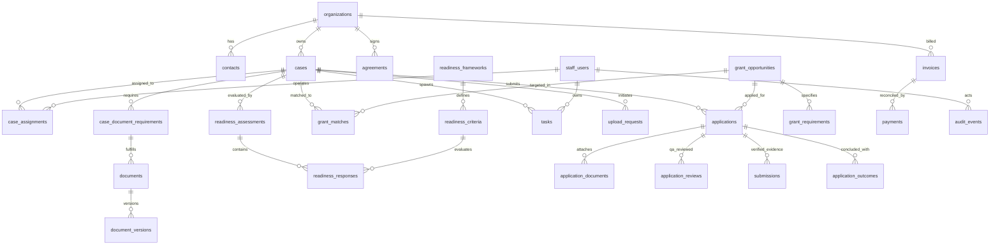

# KIA Grant Management System 2.0 — Database Schema & DDL Specification

**Engine:** PostgreSQL 15+ (Supabase)  
**Schema Version:** 2.0.0-draft  
**Date:** November 12, 2026

---

## 1. Schema Design Principles

1. **UUID Primary Keys:** All tables use `uuid_generate_v4()` or `gen_random_uuid()` to prevent enumeration attacks.
2. **Referential Integrity:** Strong foreign keys with `ON DELETE RESTRICT` for financial and audit trails, and `ON DELETE CASCADE` only for dependent join entities.
3. **Audit Attribution:** Every core entity records `created_at`, `updated_at`, `created_by`, and `updated_by`.
4. **Explicit Enums:** Typed enumerations for workflow states, roles, and priorities to eliminate invalid states.
5. **Row Level Security (RLS):** All tables have RLS enabled with granular policies based on user roles and assignment.
6. **Private File References:** Storage buckets store only UUID-prefixed file paths; no confidential files are stored in database rows.

---

## 2. Entity Relationship Diagram (ERD)



---

## 3. Core PostgreSQL DDL Definitions

```sql
-- Enable necessary extensions
CREATE EXTENSION IF NOT EXISTS "uuid-ossp";
CREATE EXTENSION IF NOT EXISTS "pgcrypto";

-- ============================================================================
-- ENUM TYPES
-- ============================================================================

CREATE TYPE staff_role_enum AS ENUM (
    'ceo',
    'team_leader',
    'application_officer',
    'finance_officer',
    'admin'
);

CREATE TYPE case_status_enum AS ENUM (
    'intake',
    'onboarding_fee_pending',
    'documentation',
    'readiness_assessment',
    'grant_matching',
    'application_development',
    'internal_review',
    'approved_for_submission',
    'submitted',
    'under_funder_review',
    'outcome_recorded',
    'waiting_on_client',
    'waiting_on_funder',
    'on_hold',
    'withdrawn',
    'closed'
);

CREATE TYPE document_status_enum AS ENUM (
    'not_required',
    'missing',
    'requested',
    'uploaded',
    'under_review',
    'verified',
    'correction_required',
    'rejected',
    'expired'
);

CREATE TYPE opportunity_status_enum AS ENUM (
    'draft',
    'pending_verification',
    'verified_open',
    'upcoming',
    'closed',
    'expired',
    'suspended',
    'archived'
);

CREATE TYPE application_status_enum AS ENUM (
    'opportunity_selected',
    'eligibility_review',
    'information_collection',
    'proposal_preparation',
    'budget_preparation',
    'internal_review',
    'client_confirmation',
    'approved_for_submission',
    'submitted',
    'under_funder_review',
    'decision_received',
    'awarded',
    'rejected',
    'closed',
    'withdrawn'
);

CREATE TYPE task_priority_enum AS ENUM ('low', 'medium', 'high', 'urgent');

CREATE TYPE task_status_enum AS ENUM (
    'pending',
    'in_progress',
    'waiting_on_client',
    'waiting_on_funder',
    'blocked',
    'completed',
    'cancelled'
);

CREATE TYPE invoice_status_enum AS ENUM ('draft', 'issued', 'partially_paid', 'paid', 'cancelled', 'refunded');
CREATE TYPE payment_status_enum AS ENUM ('pending_verification', 'verified', 'rejected', 'reconciled');
CREATE TYPE payment_method_enum AS ENUM ('momo_mtn', 'momo_telecel', 'momo_at', 'bank_transfer', 'bank_deposit', 'cash', 'other');

-- ============================================================================
-- 1. USERS & ROLES
-- ============================================================================

CREATE TABLE staff_users (
    id UUID PRIMARY KEY REFERENCES auth.users(id) ON DELETE CASCADE,
    email TEXT UNIQUE NOT NULL,
    full_name TEXT NOT NULL,
    phone_number TEXT,
    role staff_role_enum NOT NULL DEFAULT 'application_officer',
    is_active BOOLEAN NOT NULL DEFAULT true,
    created_at TIMESTAMPTZ NOT NULL DEFAULT now(),
    updated_at TIMESTAMPTZ NOT NULL DEFAULT now()
);

-- ============================================================================
-- 2. CRM: ORGANIZATIONS & CONTACTS
-- ============================================================================

CREATE TABLE organizations (
    id UUID PRIMARY KEY DEFAULT gen_random_uuid(),
    legal_name TEXT NOT NULL,
    trading_name TEXT,
    applicant_type TEXT NOT NULL, -- Startup, SME, NGO, Cooperative, Individual
    sector TEXT NOT NULL,         -- Agribusiness, Tech, Manufacturing, etc.
    business_stage TEXT NOT NULL, -- Idea, Pre-revenue, Early-stage, Growth
    registration_type TEXT,       -- Sole Proprietorship, Limited Liability, LBG, Unregistered
    registration_number TEXT,     -- ORC / RGD registration number
    tin_number TEXT,              -- Tax Identification Number / Ghana Card PIN
    year_established INT,
    region TEXT NOT NULL DEFAULT 'Greater Accra',
    district TEXT,
    address TEXT,
    website TEXT,
    created_by UUID REFERENCES staff_users(id),
    created_at TIMESTAMPTZ NOT NULL DEFAULT now(),
    updated_at TIMESTAMPTZ NOT NULL DEFAULT now()
);

CREATE TABLE contacts (
    id UUID PRIMARY KEY DEFAULT gen_random_uuid(),
    organization_id UUID NOT NULL REFERENCES organizations(id) ON DELETE CASCADE,
    full_name TEXT NOT NULL,
    title TEXT,
    email TEXT,
    phone_primary TEXT NOT NULL,
    phone_whatsapp TEXT,
    is_primary BOOLEAN NOT NULL DEFAULT false,
    id_card_type TEXT,            -- Ghana Card, Passport, Voter ID
    id_card_number TEXT,
    created_at TIMESTAMPTZ NOT NULL DEFAULT now(),
    updated_at TIMESTAMPTZ NOT NULL DEFAULT now()
);

-- ============================================================================
-- 3. CASES & ASSIGNMENTS
-- ============================================================================

CREATE TABLE cases (
    id UUID PRIMARY KEY DEFAULT gen_random_uuid(),
    case_number TEXT UNIQUE NOT NULL, -- e.g. 'KIA-CASE-2026-0001'
    organization_id UUID NOT NULL REFERENCES organizations(id) ON DELETE RESTRICT,
    primary_contact_id UUID REFERENCES contacts(id),
    status case_status_enum NOT NULL DEFAULT 'intake',
    current_officer_id UUID REFERENCES staff_users(id),
    onboarding_date DATE NOT NULL DEFAULT CURRENT_DATE,
    last_activity_at TIMESTAMPTZ NOT NULL DEFAULT now(),
    next_action_description TEXT,
    next_action_due_date DATE,
    waiting_reason TEXT,
    inactivity_flag BOOLEAN NOT NULL DEFAULT false,
    created_at TIMESTAMPTZ NOT NULL DEFAULT now(),
    updated_at TIMESTAMPTZ NOT NULL DEFAULT now()
);

CREATE TABLE case_assignments (
    id UUID PRIMARY KEY DEFAULT gen_random_uuid(),
    case_id UUID NOT NULL REFERENCES cases(id) ON DELETE CASCADE,
    assigned_officer_id UUID NOT NULL REFERENCES staff_users(id),
    assigned_by UUID NOT NULL REFERENCES staff_users(id),
    assigned_at TIMESTAMPTZ NOT NULL DEFAULT now(),
    unassigned_at TIMESTAMPTZ,
    reassignment_reason TEXT,
    is_active BOOLEAN NOT NULL DEFAULT true
);

-- ============================================================================
-- 4. AGREEMENTS & FINANCIALS
-- ============================================================================

CREATE TABLE agreements (
    id UUID PRIMARY KEY DEFAULT gen_random_uuid(),
    case_id UUID NOT NULL REFERENCES cases(id) ON DELETE RESTRICT,
    organization_id UUID NOT NULL REFERENCES organizations(id),
    agreement_number TEXT UNIQUE NOT NULL,
    version INT NOT NULL DEFAULT 1,
    engagement_fee_amount NUMERIC(12, 2) NOT NULL DEFAULT 200.00,
    success_fee_percentage NUMERIC(5, 2) NOT NULL DEFAULT 5.00,
    terms_summary TEXT,
    signed_date DATE,
    status TEXT NOT NULL DEFAULT 'draft', -- draft, pending_signature, active, expired, cancelled
    signed_document_url TEXT,
    created_at TIMESTAMPTZ NOT NULL DEFAULT now(),
    updated_at TIMESTAMPTZ NOT NULL DEFAULT now()
);

CREATE TABLE invoices (
    id UUID PRIMARY KEY DEFAULT gen_random_uuid(),
    invoice_number TEXT UNIQUE NOT NULL, -- e.g. 'KIA-INV-2026-0001'
    case_id UUID NOT NULL REFERENCES cases(id) ON DELETE RESTRICT,
    organization_id UUID NOT NULL REFERENCES organizations(id),
    agreement_id UUID REFERENCES agreements(id),
    invoice_type TEXT NOT NULL DEFAULT 'onboarding_fee', -- onboarding_fee, success_fee, consulting_fee
    amount_due NUMERIC(12, 2) NOT NULL,
    amount_paid NUMERIC(12, 2) NOT NULL DEFAULT 0.00,
    currency TEXT NOT NULL DEFAULT 'GHS',
    status invoice_status_enum NOT NULL DEFAULT 'issued',
    issued_date DATE NOT NULL DEFAULT CURRENT_DATE,
    due_date DATE NOT NULL,
    created_by UUID REFERENCES staff_users(id),
    created_at TIMESTAMPTZ NOT NULL DEFAULT now(),
    updated_at TIMESTAMPTZ NOT NULL DEFAULT now()
);

CREATE TABLE payments (
    id UUID PRIMARY KEY DEFAULT gen_random_uuid(),
    invoice_id UUID NOT NULL REFERENCES invoices(id) ON DELETE RESTRICT,
    case_id UUID NOT NULL REFERENCES cases(id) ON DELETE RESTRICT,
    amount NUMERIC(12, 2) NOT NULL,
    currency TEXT NOT NULL DEFAULT 'GHS',
    payment_method payment_method_enum NOT NULL,
    transaction_reference TEXT NOT NULL, -- Mobile Money TxID or Bank Reference
    payer_name TEXT,
    payment_date DATE NOT NULL,
    status payment_status_enum NOT NULL DEFAULT 'pending_verification',
    verified_by UUID REFERENCES staff_users(id),
    verified_at TIMESTAMPTZ,
    receipt_document_url TEXT,
    verification_notes TEXT,
    created_at TIMESTAMPTZ NOT NULL DEFAULT now()
);

-- ============================================================================
-- 5. DOCUMENT REQUIREMENTS & MANAGEMENT
-- ============================================================================

CREATE TABLE document_requirement_templates (
    id UUID PRIMARY KEY DEFAULT gen_random_uuid(),
    code TEXT UNIQUE NOT NULL, -- e.g. 'ORC_REG_CERT', 'FIN_STATEMENTS_2YR'
    name TEXT NOT NULL,
    category TEXT NOT NULL,   -- Legal, Financial, Governance, Operational, Technical
    description TEXT,
    default_mandatory BOOLEAN NOT NULL DEFAULT true,
    applicable_applicant_types TEXT[] NOT NULL DEFAULT '{}',
    applicable_sectors TEXT[] NOT NULL DEFAULT '{}',
    created_at TIMESTAMPTZ NOT NULL DEFAULT now()
);

CREATE TABLE case_document_requirements (
    id UUID PRIMARY KEY DEFAULT gen_random_uuid(),
    case_id UUID NOT NULL REFERENCES cases(id) ON DELETE CASCADE,
    template_id UUID REFERENCES document_requirement_templates(id),
    document_name TEXT NOT NULL,
    category TEXT NOT NULL,
    is_mandatory BOOLEAN NOT NULL DEFAULT true,
    status document_status_enum NOT NULL DEFAULT 'missing',
    rejection_reason TEXT,
    verified_by UUID REFERENCES staff_users(id),
    verified_at TIMESTAMPTZ,
    notes TEXT,
    created_at TIMESTAMPTZ NOT NULL DEFAULT now(),
    updated_at TIMESTAMPTZ NOT NULL DEFAULT now()
);

CREATE TABLE documents (
    id UUID PRIMARY KEY DEFAULT gen_random_uuid(),
    case_id UUID NOT NULL REFERENCES cases(id) ON DELETE CASCADE,
    case_requirement_id UUID REFERENCES case_document_requirements(id) ON DELETE SET NULL,
    file_name TEXT NOT NULL,
    file_size_bytes BIGINT NOT NULL,
    mime_type TEXT NOT NULL,
    storage_path TEXT NOT NULL, -- UUID-prefixed path in private bucket
    status document_status_enum NOT NULL DEFAULT 'uploaded',
    uploaded_by_type TEXT NOT NULL DEFAULT 'staff', -- staff, client_link
    uploaded_by_user UUID REFERENCES staff_users(id),
    upload_request_id UUID,
    checksum_sha256 TEXT,
    created_at TIMESTAMPTZ NOT NULL DEFAULT now(),
    updated_at TIMESTAMPTZ NOT NULL DEFAULT now()
);

CREATE TABLE document_versions (
    id UUID PRIMARY KEY DEFAULT gen_random_uuid(),
    document_id UUID NOT NULL REFERENCES documents(id) ON DELETE CASCADE,
    version_number INT NOT NULL,
    storage_path TEXT NOT NULL,
    file_name TEXT NOT NULL,
    uploaded_at TIMESTAMPTZ NOT NULL DEFAULT now(),
    uploaded_by_type TEXT NOT NULL,
    uploaded_by_user UUID REFERENCES staff_users(id)
);

CREATE TABLE upload_requests (
    id UUID PRIMARY KEY DEFAULT gen_random_uuid(),
    case_id UUID NOT NULL REFERENCES cases(id) ON DELETE CASCADE,
    token_hash TEXT UNIQUE NOT NULL, -- SHA-256 hash of plaintext token
    requested_by UUID NOT NULL REFERENCES staff_users(id),
    expires_at TIMESTAMPTZ NOT NULL,
    is_revoked BOOLEAN NOT NULL DEFAULT false,
    revoked_at TIMESTAMPTZ,
    revocation_reason TEXT,
    target_requirements UUID[] NOT NULL DEFAULT '{}',
    accessed_count INT NOT NULL DEFAULT 0,
    last_accessed_at TIMESTAMPTZ,
    created_at TIMESTAMPTZ NOT NULL DEFAULT now()
);

-- ============================================================================
-- 6. READINESS ASSESSMENT FRAMEWORK
-- ============================================================================

CREATE TABLE readiness_frameworks (
    id UUID PRIMARY KEY DEFAULT gen_random_uuid(),
    version TEXT NOT NULL UNIQUE, -- e.g. 'v2.0-2026'
    name TEXT NOT NULL,
    total_max_points INT NOT NULL DEFAULT 100,
    is_active BOOLEAN NOT NULL DEFAULT true,
    created_at TIMESTAMPTZ NOT NULL DEFAULT now()
);

CREATE TABLE readiness_criteria (
    id UUID PRIMARY KEY DEFAULT gen_random_uuid(),
    framework_id UUID NOT NULL REFERENCES readiness_frameworks(id) ON DELETE CASCADE,
    pillar_code TEXT NOT NULL,   -- legal, business_model, documentation, etc.
    pillar_name TEXT NOT NULL,
    pillar_weight INT NOT NULL,
    criterion_code TEXT NOT NULL UNIQUE, -- e.g. 'legal_reg', 'fin_projections'
    title TEXT NOT NULL,
    description TEXT,
    max_score INT NOT NULL DEFAULT 5,
    guidance JSONB NOT NULL DEFAULT '{}',
    fix_action TEXT NOT NULL,
    sort_order INT NOT NULL DEFAULT 0
);

CREATE TABLE readiness_assessments (
    id UUID PRIMARY KEY DEFAULT gen_random_uuid(),
    case_id UUID NOT NULL REFERENCES cases(id) ON DELETE CASCADE,
    framework_id UUID NOT NULL REFERENCES readiness_frameworks(id),
    assessor_id UUID NOT NULL REFERENCES staff_users(id),
    total_score INT NOT NULL CHECK (total_score >= 0 AND total_score <= 100),
    tier_label TEXT NOT NULL, -- Highly Ready, Moderately Ready, Low Readiness, Not Grant-Ready
    assessment_notes TEXT,
    is_latest BOOLEAN NOT NULL DEFAULT true,
    created_at TIMESTAMPTZ NOT NULL DEFAULT now()
);

CREATE TABLE readiness_responses (
    id UUID PRIMARY KEY DEFAULT gen_random_uuid(),
    assessment_id UUID NOT NULL REFERENCES readiness_assessments(id) ON DELETE CASCADE,
    criterion_id UUID NOT NULL REFERENCES readiness_criteria(id),
    score INT NOT NULL CHECK (score >= 0 AND score <= 5),
    is_not_applicable BOOLEAN NOT NULL DEFAULT false,
    evaluator_comment TEXT,
    supporting_document_id UUID REFERENCES documents(id) ON DELETE SET NULL,
    created_at TIMESTAMPTZ NOT NULL DEFAULT now()
);

-- ============================================================================
-- 7. GRANT OPPORTUNITIES & MATCHING
-- ============================================================================

CREATE TABLE grant_opportunities (
    id UUID PRIMARY KEY DEFAULT gen_random_uuid(),
    opportunity_code TEXT UNIQUE NOT NULL, -- e.g. 'GRANT-YOUSTART-2026'
    title TEXT NOT NULL,
    funding_organization TEXT NOT NULL,
    official_source_url TEXT NOT NULL,
    description TEXT NOT NULL,
    target_sectors TEXT[] NOT NULL DEFAULT '{}',
    eligible_applicant_types TEXT[] NOT NULL DEFAULT '{}',
    eligible_business_stages TEXT[] NOT NULL DEFAULT '{}',
    eligible_regions TEXT[] NOT NULL DEFAULT '{}',
    min_funding_amount NUMERIC(14, 2),
    max_funding_amount NUMERIC(14, 2),
    currency TEXT NOT NULL DEFAULT 'GHS',
    min_readiness_score INT NOT NULL DEFAULT 50,
    opening_date DATE,
    closing_date DATE,
    deadline_timezone TEXT NOT NULL DEFAULT 'Africa/Accra',
    application_method TEXT NOT NULL, -- Online Portal, Email, Physical
    has_application_fee BOOLEAN NOT NULL DEFAULT false,
    status opportunity_status_enum NOT NULL DEFAULT 'draft',
    verified_by UUID REFERENCES staff_users(id),
    verified_at TIMESTAMPTZ,
    internal_notes TEXT,
    created_at TIMESTAMPTZ NOT NULL DEFAULT now(),
    updated_at TIMESTAMPTZ NOT NULL DEFAULT now()
);

CREATE TABLE grant_matches (
    id UUID PRIMARY KEY DEFAULT gen_random_uuid(),
    case_id UUID NOT NULL REFERENCES cases(id) ON DELETE CASCADE,
    opportunity_id UUID NOT NULL REFERENCES grant_opportunities(id) ON DELETE CASCADE,
    match_classification TEXT NOT NULL, -- Potential Match, Eligible Verified, Info Required, Disqualified
    satisfied_criteria TEXT[] NOT NULL DEFAULT '{}',
    missing_criteria TEXT[] NOT NULL DEFAULT '{}',
    disqualifying_reasons TEXT[] NOT NULL DEFAULT '{}',
    reviewed_by UUID REFERENCES staff_users(id),
    recommended_action TEXT,
    created_at TIMESTAMPTZ NOT NULL DEFAULT now(),
    updated_at TIMESTAMPTZ NOT NULL DEFAULT now(),
    UNIQUE(case_id, opportunity_id)
);

-- ============================================================================
-- 8. GRANT APPLICATIONS & QA
-- ============================================================================

CREATE TABLE applications (
    id UUID PRIMARY KEY DEFAULT gen_random_uuid(),
    application_number TEXT UNIQUE NOT NULL, -- e.g. 'APP-2026-0001'
    case_id UUID NOT NULL REFERENCES cases(id) ON DELETE RESTRICT,
    opportunity_id UUID NOT NULL REFERENCES grant_opportunities(id) ON DELETE RESTRICT,
    assigned_officer_id UUID NOT NULL REFERENCES staff_users(id),
    status application_status_enum NOT NULL DEFAULT 'opportunity_selected',
    target_funding_amount NUMERIC(14, 2),
    currency TEXT NOT NULL DEFAULT 'GHS',
    funder_deadline TIMESTAMPTZ NOT NULL,
    internal_qa_deadline TIMESTAMPTZ NOT NULL,
    qa_approved_by UUID REFERENCES staff_users(id),
    qa_approved_at TIMESTAMPTZ,
    client_confirmed_at TIMESTAMPTZ,
    submission_evidence_url TEXT,
    submission_reference_number TEXT,
    submitted_at TIMESTAMPTZ,
    submitted_by UUID REFERENCES staff_users(id),
    outcome_status TEXT, -- awarded, rejected, under_review
    awarded_amount NUMERIC(14, 2),
    award_date DATE,
    award_evidence_url TEXT,
    created_at TIMESTAMPTZ NOT NULL DEFAULT now(),
    updated_at TIMESTAMPTZ NOT NULL DEFAULT now()
);

CREATE TABLE application_reviews (
    id UUID PRIMARY KEY DEFAULT gen_random_uuid(),
    application_id UUID NOT NULL REFERENCES applications(id) ON DELETE CASCADE,
    reviewer_id UUID NOT NULL REFERENCES staff_users(id),
    review_stage TEXT NOT NULL, -- proposal_review, budget_review, final_qa
    decision TEXT NOT NULL,     -- approved, revisions_required, rejected
    feedback_notes TEXT NOT NULL,
    reviewed_at TIMESTAMPTZ NOT NULL DEFAULT now()
);

-- ============================================================================
-- 9. TASKS & ACCOUNTABILITY
-- ============================================================================

CREATE TABLE tasks (
    id UUID PRIMARY KEY DEFAULT gen_random_uuid(),
    task_number TEXT UNIQUE NOT NULL, -- e.g. 'TSK-2026-0001'
    case_id UUID REFERENCES cases(id) ON DELETE CASCADE,
    application_id UUID REFERENCES applications(id) ON DELETE CASCADE,
    title TEXT NOT NULL,
    description TEXT,
    assigned_to UUID NOT NULL REFERENCES staff_users(id),
    created_by UUID NOT NULL REFERENCES staff_users(id),
    priority task_priority_enum NOT NULL DEFAULT 'medium',
    status task_status_enum NOT NULL DEFAULT 'pending',
    due_date DATE NOT NULL,
    completed_at TIMESTAMPTZ,
    completion_evidence TEXT,
    escalation_level INT NOT NULL DEFAULT 0, -- 0 = normal, 1 = escalated to TL, 2 = escalated to CEO
    escalated_at TIMESTAMPTZ,
    created_at TIMESTAMPTZ NOT NULL DEFAULT now(),
    updated_at TIMESTAMPTZ NOT NULL DEFAULT now()
);

-- ============================================================================
-- 10. AUTOMATION & AUDIT
-- ============================================================================

CREATE TABLE audit_events (
    id UUID PRIMARY KEY DEFAULT gen_random_uuid(),
    actor_id UUID REFERENCES staff_users(id),
    actor_type TEXT NOT NULL DEFAULT 'staff', -- staff, client_token, system_automation
    entity_type TEXT NOT NULL,               -- case, document, payment, application, task
    entity_id UUID NOT NULL,
    action TEXT NOT NULL,                    -- create, update, verify, reject, escalate, delete
    previous_state JSONB,
    new_state JSONB,
    ip_address INET,
    user_agent TEXT,
    created_at TIMESTAMPTZ NOT NULL DEFAULT now()
);

CREATE TABLE automation_rules (
    id UUID PRIMARY KEY DEFAULT gen_random_uuid(),
    name TEXT NOT NULL,
    trigger_type TEXT NOT NULL, -- overdue_task, inactive_case, deadline_warning, missing_document
    config JSONB NOT NULL DEFAULT '{}',
    is_active BOOLEAN NOT NULL DEFAULT true,
    created_at TIMESTAMPTZ NOT NULL DEFAULT now()
);

CREATE TABLE automation_executions (
    id UUID PRIMARY KEY DEFAULT gen_random_uuid(),
    rule_id UUID REFERENCES automation_rules(id),
    trigger_type TEXT NOT NULL,
    target_entity_type TEXT NOT NULL,
    target_entity_id UUID NOT NULL,
    status TEXT NOT NULL, -- success, failure, skipped
    result_summary TEXT,
    executed_at TIMESTAMPTZ NOT NULL DEFAULT now()
);

CREATE TABLE legacy_migration_staging (
    id UUID PRIMARY KEY DEFAULT gen_random_uuid(),
    legacy_id TEXT UNIQUE NOT NULL,
    raw_data JSONB NOT NULL,
    parsed_client_name TEXT,
    parsed_business_name TEXT,
    parsed_sector TEXT,
    parsed_commitment_fee_paid BOOLEAN,
    migration_status TEXT NOT NULL DEFAULT 'quarantined', -- quarantined, validated, migrated, rejected
    reconciliation_notes TEXT,
    migrated_case_id UUID REFERENCES cases(id),
    reconciled_by UUID REFERENCES staff_users(id),
    reconciled_at TIMESTAMPTZ,
    created_at TIMESTAMPTZ NOT NULL DEFAULT now()
);
```

---

## 4. Key Triggers and Automated Consistency

1. **Auto-Update Timestamp:** All tables possess an `updated_at` trigger invoking a shared function:
   ```sql
   CREATE OR REPLACE FUNCTION update_updated_at_column()
   RETURNS TRIGGER AS $$
   BEGIN
       NEW.updated_at = now();
       RETURN NEW;
   END;
   $$ language 'plpgsql';
   ```
2. **Audit Event Trigger:** Key state transitions on `payments`, `case_document_requirements`, and `applications` automatically log entries into `audit_events`.
3. **Case Inactivity Trigger:** When tasks or documents are modified for a case, `cases.last_activity_at` updates automatically to prevent false inactivity alerts.
