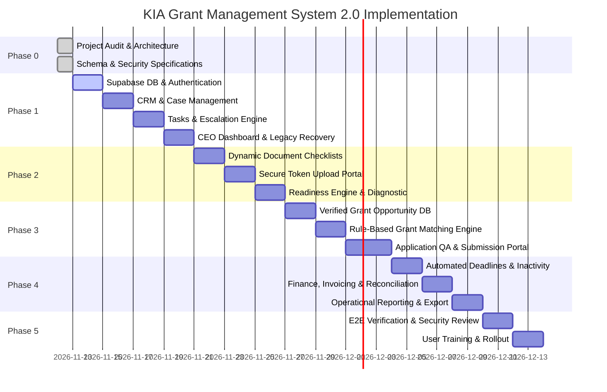

# KIA Grant Management System 2.0 — Implementation Roadmap & Execution Plan

**Project:** KIA Grant Management System 2.0  
**Methodology:** Incremental, Test-Driven, Low-Risk Delivery  
**Date:** November 12, 2026

---

## 1. Implementation Philosophy

1. **Working Software at Every Phase:** The application remains fully functional, testable, and demonstrable between phases.
2. **Strict Change Control:** No destructive alterations to existing code or data without version control checkpoints and verified backups.
3. **Evidence Over Assumptions:** No synthetic data, no fictional dashboard counters, no unverified operational claims.

---

## 2. Phase Breakdown & Work Breakdown Structure (WBS)

---

## 3. Detailed Phase Work Packages

### PHASE 0 — Technical & Operational Audit (COMPLETED)
- Inspect existing codebase, dependencies, data structures, and UI.
- Identify architectural defects, security vulnerabilities, and operational gaps.
- Formalize target architecture, PostgreSQL schema, workflows, security rules, and test strategy.
- Initialize baseline version control checkpoint (`master` commit).

### PHASE 1 — Core Operations & Foundation
- **Objectives:** Establish central database, authentication, user roles, centralized client cases, case assignments, task management, and the CEO operational dashboard.
- **Deliverables:**
  1. Supabase PostgreSQL migrations (Users, CRM, Cases, Assignments, Tasks, Audit, Legacy Staging).
  2. Supabase client configuration and environment variable setup (`.env.example`).
  3. Staff Authentication & Role Switcher/Profile system.
  4. Client CRM & Case Management Interface (replacing `initialClients.js` and `localStorage`).
  5. Team Task Management Workbench (My Tasks, Due Today, Overdue, Level 1 & 2 Escalations).
  6. CEO Management Dashboard (real-time metrics, bottleneck radar, active workload).
  7. Legacy Client Recovery Workbench (staging the 14 baseline clients for structured reconciliation).
- **Acceptance Criteria:**
  - Multi-user authentication operates smoothly with distinct roles.
  - Case assignments and tasks persist centrally in PostgreSQL.
  - Overdue tasks trigger escalation flags to Team Leader and CEO.
  - Zero reliance on `localStorage` for authoritative business records.

### PHASE 2 — Intelligent Document Management & Readiness
- **Objectives:** Eliminate document collection delays and formalize evidence-backed readiness diagnostics.
- **Deliverables:**
  1. Dynamic checklist generator based on applicant type, sector, and grant requirements.
  2. Cryptographic token-based client upload link generator (`/upload?token=...`).
  3. Client mobile/desktop upload interface with file drag-and-drop and real-time validation.
  4. Staff Document Review Desk (preview, approve, reject with specific remediation notes).
  5. Refactored Readiness Assessment Engine (20 sub-criteria, evidence attachments, evaluator attribution).
  6. Gap Analysis and official A4 Printable Diagnostic Report.
- **Acceptance Criteria:**
  - Clients can upload documents via secure token link without password creation.
  - Document uploads automatically create review tasks for assigned officers.
  - Readiness scores calculate accurately and require staff evaluator attribution.

### PHASE 3 — Grant Discovery, Matching & Application Pipeline
- **Objectives:** Build verified grant opportunity management and a rigorous pre-submission quality gate.
- **Deliverables:**
  1. Verified Grant Opportunity Catalogue with official source URLs and verification statuses.
  2. Rule-based Explainable Grant Matching Engine (evaluating eligibility, legal type, sector, age, turnover).
  3. Multi-stage Application Preparation Pipeline (Proposal, Budget, Attachments).
  4. Internal QA Review Gate with Team Leader sign-off.
  5. Submission Verification Desk requiring funder confirmation receipt and reference number.
  6. Grant Outcome and Success Fee Trigger module.
- **Acceptance Criteria:**
  - Matching engine outputs transparent reasons for qualification or disqualification.
  - Applications cannot be marked submitted without verified submission evidence.

### PHASE 4 — Automation, Finance & Advanced Reporting
- **Objectives:** Automate repetitive reminders and establish robust financial reconciliation.
- **Deliverables:**
  1. Automated deadline monitoring radar (14, 7, 3, 1 day alerts).
  2. Inactive case detection (>7 days warning, >14 days escalation).
  3. Invoice creation, payment recording (MoMo/bank), and Finance Officer verification.
  4. Contractual success fee obligation tracking.
  5. Operational reports (Daily Task Summary, Weekly Pipeline, Monthly Executive Report).
- **Acceptance Criteria:**
  - Payments require independent finance verification before clearing balances.
  - Inactivity alerts surface automatically on the CEO dashboard.

### PHASE 5 — Pilot, Optimization & Production Readiness
- **Objectives:** Execute end-to-end user testing, security penetration audit, and operational handover.
- **Deliverables:**
  1. Automated unit and integration test suite execution.
  2. Backup and restore validation drill.
  3. User training manual and quick-reference guides.
  4. Production deployment to Vercel/Netlify connected to production Supabase.
- **Acceptance Criteria:**
  - All critical workflows verified under realistic multi-user simulation.
  - Zero critical or high-severity defects remaining.
