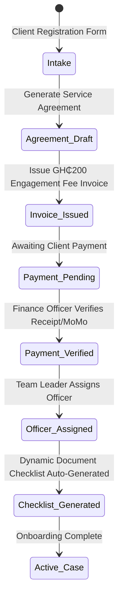
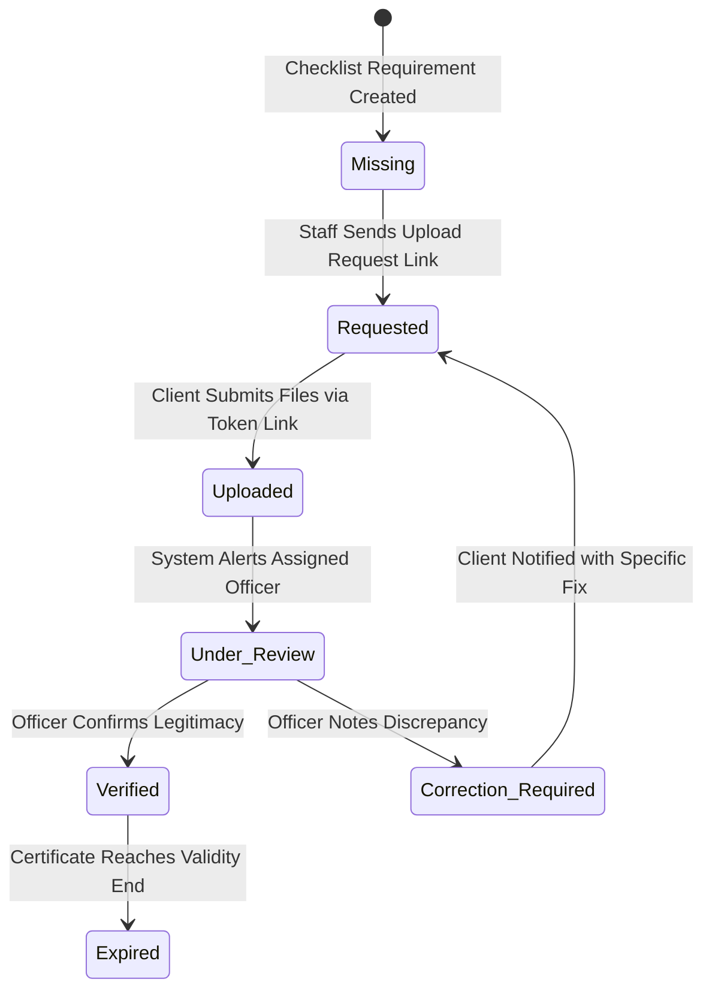
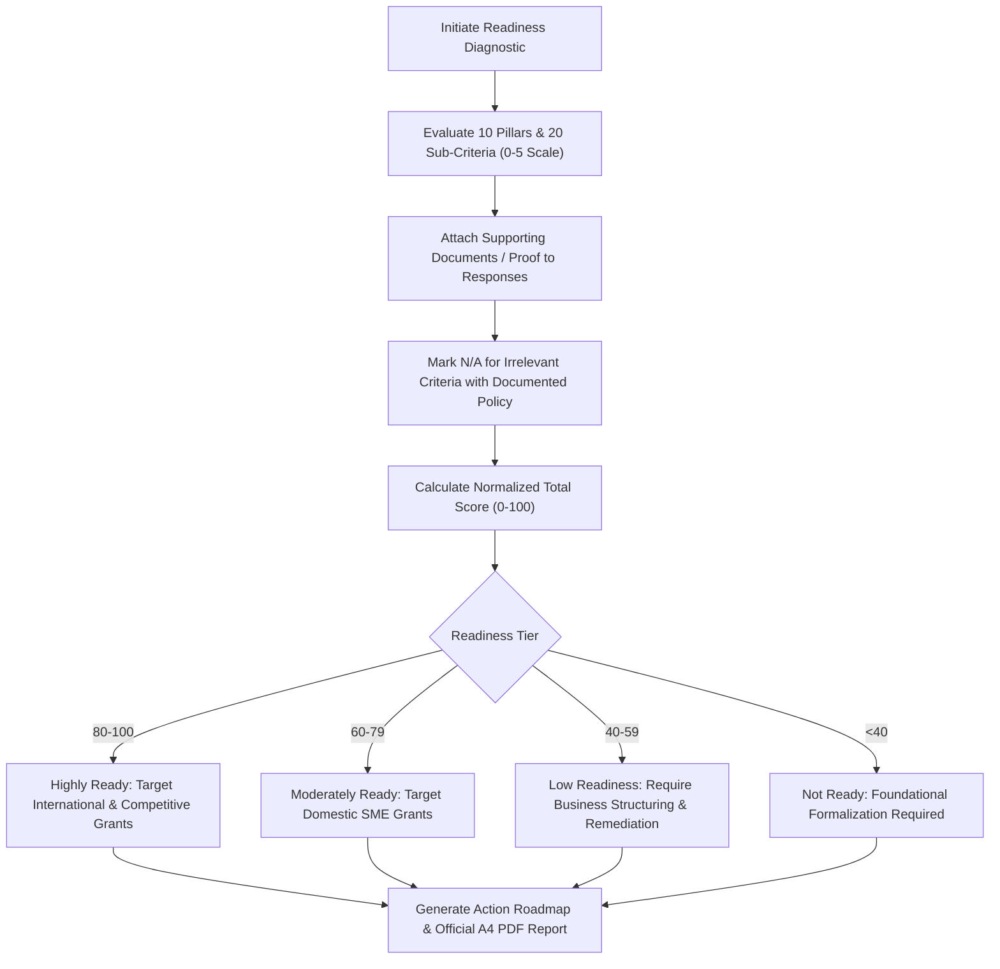
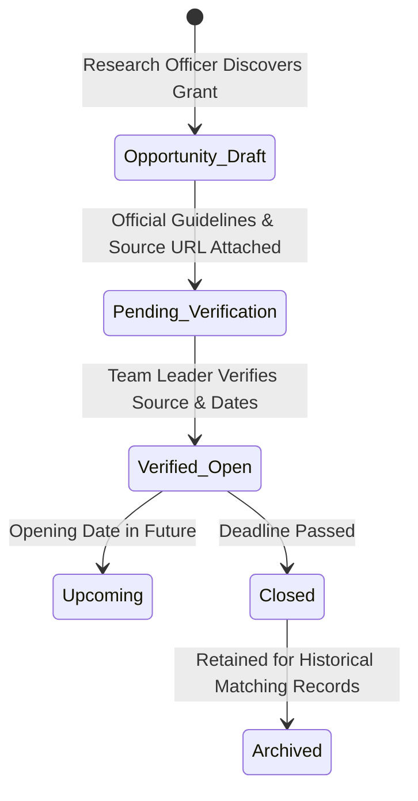
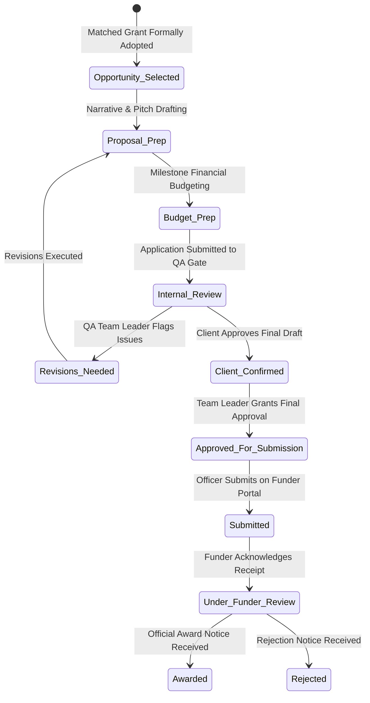
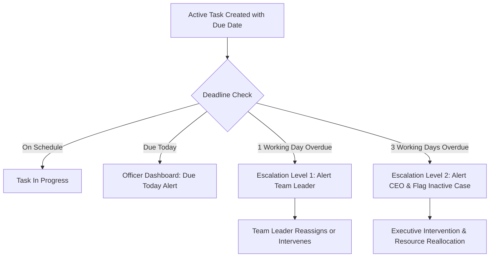

# KIA Grant Management System 2.0 — Standard Operating Workflows

**Document:** Operational State Machines & Automation Specifications  
**Audience:** Operational Staff, Team Leaders, Executive Management & Engineers  
**Date:** November 12, 2026

---

## 1. Client Onboarding & Engagement Lifecycle

### Operational Rules:
- **No Unverified Free Passes:** A case cannot advance to `Active_Case` until payment has been verified by the Finance Officer or CEO.
- **Configurable Fees:** Default is GH₵200 commitment fee, but configurable per client tier (e.g., SME vs Corporate).
- **Mandatory Ownership:** No case can advance without an assigned responsible officer and an explicit next action due date.

---

## 2. Document Collection & Verification Workflow

### Automatic Actions:
1. **Upload Trigger:** When a client submits a file via their token link:
   - Document status updates to `Uploaded`.
   - File is stored in Supabase private bucket `grant-documents/{case_id}/{req_id}/...`.
   - A verification task is automatically spawned for the assigned officer (due within 24 hours).
   - Case `last_activity_at` updates to `now()`.
2. **Rejection Safeguard:** When an officer marks a document `Correction_Required`, they **must** specify the exact reason (e.g., "ORC Form 3 page 2 is missing signature"). An automated notification is queued for the client with a refreshed upload link.

---

## 3. Grant Readiness Assessment Workflow

### Safeguards:
- Default scores are **never** populated automatically.
- High scores do **not** automatically mark physical documents as verified.
- Readiness scores alone do **not** guarantee grant eligibility.

---

## 4. Grant Opportunity & Matching Lifecycle

### Explainable Matching Rules:
The system evaluates each open grant against verified case attributes:
1. **Applicant Structure Match:** Company legal type (LLC, Sole Prop, NGO) must match grant criteria.
2. **Sector & Geography Match:** Case sector and operational region must match funder target zones.
3. **Turnover & Age Constraints:** Must satisfy funder operating track record requirements.
4. **Readiness Threshold:** Client score must meet or exceed `grant.min_readiness_score`.
5. **Output:** Clear classification: `Eligible Verified`, `Information Required`, or `Disqualified`, detailing exactly which criteria passed or failed.

---

## 5. Application Preparation & Submission Workflow

### Critical Submission Safeguards:
- An application **cannot** be marked `Approved_For_Submission` unless:
  - All mandatory grant documents are verified.
  - Team Leader QA sign-off is logged in `application_reviews`.
  - Client confirmation timestamp is recorded.
- An application **cannot** be marked `Submitted` without:
  - Funder submission reference number.
  - Attached submission confirmation screenshot/receipt.
  - Submitting officer attribution and timestamp.

---

## 6. Team Tasks & Multi-Level Escalation Engine

### Inactivity Detection:
- Active cases with no logged audit events, document updates, or task completions for >7 days trigger a warning to the officer.
- Cases inactive for >14 days are flagged on the CEO Dashboard as **Bottlenecks Requiring Intervention**.

